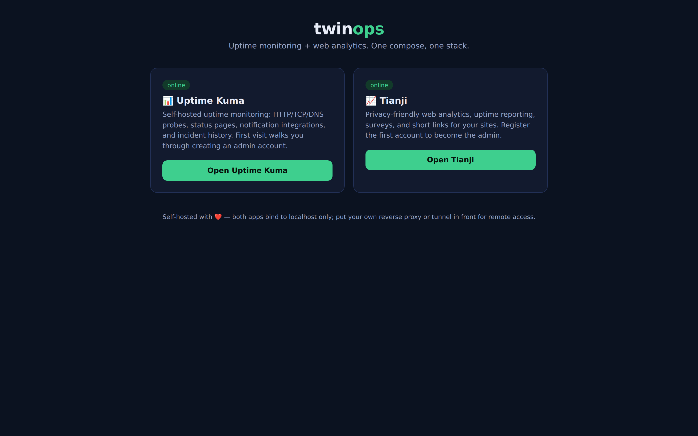

<div align="center">

# twinops

**Uptime monitoring + privacy-friendly web analytics in one compose stack.**

Brings together two of the best self-hosted tools — [Uptime Kuma](https://github.com/louislam/uptime-kuma) and [Tianji](https://github.com/msgbyte/tianji) — with a single landing portal, one command to start, and everything bound to localhost behind your own proxy or tunnel.

[](https://github.com/OneByJorah/twinops/actions/workflows/ci.yml)
[](https://www.docker.com/)
[](https://opensource.org/licenses/MIT)



</div>

## What's Inside

| Service | Upstream | Role | Port (localhost) |
| ------- | -------- | ---- | ---------------- |
| **Uptime Kuma** | `louislam/uptime-kuma:1` | Uptime probes (HTTP/TCP/DNS/push), status pages, alerting | `3001` |
| **Tianji** | `moonrailgun/tianji` | Privacy-friendly web analytics, surveys, short links, server status | `12345` |
| **Tianji Postgres** | `postgres:15.4-alpine` | Tianji's data store | internal |
| **Portal** | built from `portal/` | Landing page with live service status | `8080` |

## How The Apps Were Analyzed

This packaging was informed by REA (Reverse Engineer Anything) static-analysis
passes over both upstream codebases:

- **uptime-kuma `server/`** — 215 JavaScript files, 101,131 AST nodes, 2,551 findings, 0 parse failures. Confirms a self-contained Express + Socket.IO server on SQLite (`better-sqlite3`) with no external database dependency — which is why it needs only a data volume here.
- **tianji `src/server/`** — 377 JavaScript files, 271,682 AST nodes, 6,175 findings. Confirms the server-side dependency on a Postgres `DATABASE_URL`, `JWT_SECRET` session signing, and registration/OpenAPI toggles — which is why the stack carries Postgres and a `.env`-driven secret.

Evidence digests are recorded in [`docs/rea-analysis.md`](docs/rea-analysis.md).

## Quick Start

```bash
git clone https://github.com/OneByJorah/twinops.git
cd twinops
cp .env.example .env    # set JWT_SECRET + POSTGRES_PASSWORD (openssl rand -hex 32)
docker compose up -d --build
```

Open the portal at `http://127.0.0.1:8080` — it links both apps and shows live status.

First-run setup:

1. **Uptime Kuma** — `http://127.0.0.1:3001` → create the admin account → add monitors.
2. **Tianji** — `http://127.0.0.1:12345` → register the first account (becomes admin) → create a website and paste its tracking script into the sites you want measured.

## Remote Access

Everything binds to `127.0.0.1` on the Docker host. For family/team access, put
your own reverse proxy or Cloudflare Tunnel in front of the portal and apps.
Set `PUBLIC_URL` in `.env` when Tianji must generate absolute URLs.

## Security Notes

- No secrets in the repo — `.env` is gitignored; `.env.example` ships placeholders.
- Set `ALLOW_REGISTER=false` in `.env` once your Tianji admin account exists.
- Both apps are upstream binaries pulled from their official images; this repo
  adds no code to them.

## Repository Layout

```text
portal/            Landing page + status API (stdlib-only server)
docker-compose.yml The whole stack
scripts/           Screenshot helper
docs/              REA analysis notes
```

## Credits

All functionality belongs to the upstream projects:
[Uptime Kuma](https://github.com/louislam/uptime-kuma) (MIT) and
[Tianji](https://github.com/msgbyte/tianji) (MIT). This repository only packages
them to run side-by-side.

## License

MIT — see [LICENSE](LICENSE).
